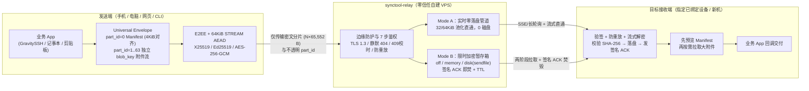

# synctool

> **独立、通用、可嵌入、零信任的按需加密同步中转组件（`synctool-v1`）**  
> 专为个人开发者与自托管场景打造：一台 256MB 小内存 VPS 即可轻松承载 SSH 配置换机、跨手机/电脑多媒体记事本（文字/图片/视频/语音定向推送），以及未来任意简易信息传输小工具。

---

## 核心特性

- **零信任中继（数据绝对安全）**：中继 VPS 仅转发/暂存密文分片，**永远拿不到明文、解密密钥、应用类型（`app_id`）、文件名、媒体类型、设备真名或离线发送者身份**；即使 VPS 被攻破、抓包或整盘拖库，也无法还原任何数据。
- **三路径 + 两套密码流（安全 × 适用 × 易用兼得）**：
  - **面对面换机 / 首次绑定（主路径）**：**QR 二维码 128-bit 线下暗码 + 临时 X25519**，一扫即连，前向保密、防离线破解、防中间人；
  - **无摄像头 / 跨城 / CLI 兜底**：**8 位 Crockford Base32 明码路由 + 3 步 Commit-Reveal X25519 + 发送端输入接收端 6 位 SAS 核验码**（防离线碰撞、防盲点同意、失败即熔断房间）；
  - **已绑定设备高频定向推送（记事本 / 剪贴板）**：**DeviceCard 0-RTT Ephemeral-Static X25519 + Ed25519 Sealed Sender**，点选目标设备一键发送，仅该目标设备私钥可解，支持**单台丢失设备精准吊销**且不误伤其他设备。
- **双模式按需中转 + 适应全档位 VPS**：
  - **Mode A（实时零落盘分块管道）**：双方同时在线时 32/64 KiB 缓冲直通，**256MB 内存小鸡也能零落盘稳传 GB 级视频**，支持弱网分块级断点续传；
  - **Mode B（限时加密暂存箱，支持 `--spool=off` 一键关闭）**：解决“手机发完笔记、电脑当时关机”的异步痛点，先拉几 KB Manifest 预览再按需断点拉大附件，全量校验落盘后由接收端发送**签名 ACK 物理焚毁**。
  - **自动分档 + 极低待机**：`--profile=auto` 自动按容器/系统内存匹配 `nano / standard / media`，无任务时 Lazy GC 休眠（空闲内存 `< 15 MiB`）。
- **万物皆可组装（业务彻底解耦）**：
  - 统一 `Parcel` 信封（`part_id=0` 加密 Manifest + `part_id=1..63` 独立密钥加密二进制流），通过 `app_id` 隔离业务；
  - **零第三方依赖**：服务端 `synctool-relay`（纯 Go 单静态二进制 ~8MB）、`sdk/go` + `synctool-cli`（纯 Go 标准库，含 `--json` 机器模式）、`sdk/ts`（纯标准 WebCrypto + `fetch`，通吃浏览器 / PWA / Node / Electron / Tauri / WebView），并由 **7 份黄金测试向量（`spec/test-vectors/`）** 保障所有语言字节级互通。

---

## 系统架构与信任边界



### 零信任安全边界速览

| 维度 | 中继 VPS **能看到** | 中继 VPS **绝对看不到** |
| :--- | :--- | :--- |
| **路由与鉴权** | 随机 8 位房间号 / 盲化 `mailbox_id` / `deposit_token` 哈希 | `app_id`、业务 Schema、用户自定义设备名 |
| **包裹内容** | 不透明数字 `part_id` (`0..63`)、密文分片长度与 TTL | 任何文字正文、图片/视频/语音明文、文件名、MIME 类型 |
| **身份与防伪** | 随机 `msg_id` 与临时公钥 $E_A$ | 离线推送发送方身份（Sealed Sender）、双方长期公钥、6 位 SAS、二维码 `oob_secret` |

---

## 全档位 VPS 预设与手动暂存开关

服务端默认启用 `--profile=auto`（自动读取 Linux cgroup / 系统物理内存选档），且随时支持用 `--spool=off`（或环境变量 `SYNCTOOL_SPOOL=off`）**强制关闭离线暂存**，只保留纯实时零落盘管道：

| 档位 (`--profile`) | 适用 VPS | 内存上限 (`GOMEMLIMIT`) | 传输分片 (`N×65,552 B`) | 默认暂存 (`--spool`) | 全局 / 单信箱 / 单包裹上限 | 默认 / 最大 TTL |
| :--- | :--- | :---: | :---: | :---: | :---: | :---: |
| **`nano`** | 256MB–512MB 小鸡 / NAT | `48 MiB` | `4` (`262,208 B`) | `memory`（纯内存） | `16 MiB` / `8 MiB` / `4 MiB` | `30m` / `2h` |
| **`standard`** | 768MB–2GB 常规 VPS | `144 MiB` | `16` (`1,048,832 B`) | `disk`（`sendfile` 零拷贝） | `512 MiB` / `256 MiB` / `100 MiB` | `24h` / `72h` |
| **`media`** | 2GB+ 大盘/高配 VPS | `384 MiB` | `32` (`2,097,664 B`) | `disk`（`sendfile` 零拷贝） | `10 GiB` / `4 GiB` / `2 GiB` | `72h` / `7d` |
| **任意档 + `--spool=off`** | 追求绝对零落盘策略 | 继承所选档位 | 继承所选档位 | **`off`（全暂存返回 `403`）** | `0`（仅允许 Mode A 零落盘直传） | - |

> 即使在 `nano` 小鸡或 `--spool=off` 模式下，只要双方同时在线，依然可以通过 **Mode A 零落盘管道**无痛传输数 GB 视频。

---

## 一键部署中继（3 种形态任选）

### 方式 1：Docker 一键部署（裸 IP 直连，无需域名）

首次初始化会自动生成高熵随机 `RELAY_ACCESS_KEY` 与 730 天含 IP SAN 的 ECDSA P-256 自签证书，并仅向当前终端打印 `synctool://relay?...#k=...` 配置链接（**严禁写死默认密钥、严禁跳过证书校验**）：

```bash
# 1. 初始化私有密钥与自签证书（将 1.2.3.4 替换为你的 VPS 公网 IP）
docker run --rm -it -v $(pwd)/data:/data \
  ghcr.io/yellowdking/synctool:latest \
  init --public-host 1.2.3.4 --listen :54843 --data-dir /data

# 2. 启动中继（默认 --profile=auto；如需彻底关闭离线暂存，加 -e SYNCTOOL_SPOOL=off）
cd deploy && docker compose up -d
```

### 方式 2：Docker + Caddy（有域名，自动 HTTPS，完美兼容浏览器/PWA）

```bash
# 编辑 deploy/Caddyfile 填入你的域名（如 sync.example.com），随后启动：
cd deploy && docker compose -f docker-compose.caddy.yml up -d
```
> 走反代时中继自动以 `--tls=off --trust-proxies=<caddy网段>` 运行，防止真实客户端 IP 误判；浏览器/PWA 版 `sdk/ts` 可直接通过系统 CA 证书无缝接入。

### 方式 3：256MB 极低配小鸡免 Docker 裸跑（`systemd` 单二进制）

省掉 `dockerd` 吃掉的 80–120 MiB 内存，空闲 RSS `< 15 MiB`：

```bash
# 从 GitHub Releases 下载对应架构的 synctool-relay 静态二进制，运行安装脚本：
sudo bash deploy/install-systemd.sh --public-host 1.2.3.4 --profile auto
# 如需纯内存零离线暂存，追加：--spool off
```

---

## 快速上手与集成示例

### 1. 万能命令行 `synctool-cli`（5 分钟组装任何脚本/小工具）

```bash
# ① 接入自建中继（强烈建议 --stdin 读入 URI，防止 #k= 进入终端历史）
echo 'synctool://relay?v=1&u=https%3A%2F%2F1.2.3.4%3A54843&pin=<64hex>#k=<key>' \
  | synctool init --stdin --label "书房台式机"

# ② 验证连通性、VPS 档位与证书有效期
synctool ping

# ③ 首次绑定两台设备（只需做一次！支持 --mode qr 扫码 或 --mode sas 核对 6 位码）
synctool pair offer --mode qr --label "书房台式机"   # 电脑端
synctool pair accept --stdin --label "我的手机"       # 另一端扫码/粘贴

# ④ 日常高频定向发送（文字 + 图片/视频/语音，自动按 VPS 配额走暂存箱）
synctool send --to "书房台式机" \
  --app com.yellowdking.notes \
  --schema note.item.v1 \
  --text "今天白板照片和录音" \
  --file ./whiteboard.jpg:image \
  --file ./memo.m4a:voice

# ⑤ 目标设备按需拉取（先列表预览 Manifest，再流式断点落盘并签名 ACK 焚毁中继副本）
synctool inbox list --app com.yellowdking.notes --json
synctool inbox pull --app com.yellowdking.notes --all --out ./received

# ⑥ 一次性换机速传（如 GravitySSH 导出，不留长期绑定）
synctool send --oneshot --app com.yellowdking.gravityssh --file ./vault.json:vault_dump
synctool recv --stdin --out ./restore

# ⑦ 手机丢失？精准吊销单台设备，其他已绑定设备零影响！
synctool device revoke <lost_device_id>
```
> 所有子命令支持 `--json`（`stdout` 纯 JSON/NDJSON 进度与结果，`stderr` 人类提示与 QR），任何 Python / Shell / AutoHotkey / Raycast 工具均可 5 分钟子进程接入。

### 2. Go SDK 嵌入示例（不到 25 行组装任意桌面/后端应用）

```go
package main

import (
    "context"
    "github.com/yellowdking/synctool/sdk/go/client"
    "github.com/yellowdking/synctool/sdk/go/envelope"
)

func pushNote(ctx context.Context, targetDeviceID string) error {
    // 1. 从环境变量 SYNCTOOL_RELAY + SYNCTOOL_CONFIG 一键加载客户端（避免命令行暴露 #k=）
    cli, err := client.NewFromEnv(client.Config{AppID: "com.yellowdking.notes"})
    if err != nil {
        return err
    }
    defer cli.Close()

    // 2. 构造通用密文包裹（大附件强制走文件路径/流，杜绝手机或电脑 OOM）
    parcel := envelope.Parcel{
        AppID:         "com.yellowdking.notes",
        Schema:        "note.item.v1",
        InlinePayload: map[string]any{"title": "灵感记录", "body": "附现场视频与截图"},
        Blobs: []envelope.BlobInput{
            envelope.BlobFromFile("image", "./shot.png", "image/png"),
            envelope.BlobFromFile("video", "./clip.mp4", "video/mp4"),
        },
    }
    // 3. 一键定向加密推送（0-RTT Sealed Sender + 64KiB STREAM AEAD 分片）
    _, err = cli.SendToDevice(ctx, targetDeviceID, parcel, client.WithDeliveryMode(client.DeliveryAuto))
    return err
}
```

### 3. TypeScript / JavaScript SDK（零依赖 WebCrypto，通吃浏览器 / Node / Electron / Tauri）

```js
import { SyncClient, NodeFileKeyStore, parseRelayURI, suggestPipeMode } from './sdk/ts/src/index.js';

// Node / Electron 本地持久化使用 NodeFileKeyStore（0700 目录 + 0600 原子重命名）；浏览器可用 IndexedDB 适配 KeyStore 接口
const store = new NodeFileKeyStore('./.synctool-state');
const relay = parseRelayURI(process.env.SYNCTOOL_RELAY);
const cli = new SyncClient({
  relay,
  keyStore: store,
  appId: 'com.yellowdking.clipboard',
  label: '桌面轻量端',
});

// 拉取并解密所有待收包裹 Manifest 预览（本地按 item_id 缓存；nano 内存信箱重启后自动无感自愈！）
const previews = await cli.listInbox({ appId: 'com.yellowdking.clipboard' });

// 按需下载具体包裹附件，校验全部 SHA-256 落盘后自动发送签名 ACK 焚毁中继副本
for (const item of previews) {
  await cli.fetchParcel(item.item_id, async ({ manifest, blobs }) => {
    console.log('收到加密消息:', manifest.inline_payload, blobs.map((b) => b.safeName));
  });
}
```
> 无需 `npm install` 即可直接运行测试：`cd sdk/ts && node --test test/*.test.mjs`。更多可直接复制运行的最小模板见 [`examples/`](./examples/)（含 `go-minimal`、`ts-minimal` 与任意语言通用的 `cli-subprocess` NDJSON 示例）。

---

## 下游应用接入与平滑升级契约（v1.x 长期免维护指南）

为确保跨端记事本、GravitySSH 及各类简易传输小工具接入后**默认安全且随 `synctool` 升级零改造**：

1. **命名空间与业务演进解耦**：每个应用使用独立 `app_id`（如 `com.yellowdking.notes`）并在 `schema` 中携带业务版本号（如 `note.item.v1`）。中继与传输层对业务内容完全无知，中继升级永远不影响业务载荷。
2. **前向兼容铁律（忽略未知字段 + 明确版本边界）**：
   - 当中继或对端升级至 `v1.1+` 在 `Manifest`、`/v1/caps`、`DeviceCard` 或 SSE 事件中新增可选扩展字段时，旧版 Go/TS SDK **100% 自动忽略未知字段，绝不崩溃或破坏 `SealedHeader` 签名缓存**。
   - 仅当未来遇到不兼容更高主版本（如 `envelope_version > 1`、URI `v > 1`、握手 `proto_v > 1`）时，SDK 稳定返回 `ERR_UNSUPPORTED_VERSION`，应用仅需用 `envelope.IsVersionMismatch(err)` / `isVersionMismatch(err)` 提示用户更新客户端。
3. **稳定错误分类器（告别硬编码 `switch code`）**：Go 与 TS SDK 双端同步提供 `IsRetryable`、`IsQuotaExceeded`、`SuggestPipeMode`、`IsAuthError`、`IsSecurityAlert`、`IsVersionMismatch`。下游程序只需按分类器分支（例如 `SuggestPipeMode(err) == true` 时引导切换双方在线 Mode A 直传），SDK 内部细分错误码演进时下游零改动。
4. **`nano` 内存暂存重启全自动自愈（Self-Healing）**：当 256MB 小鸡（`spool=memory`）重启清空内存信箱后，已绑定接收端调用 `ListInbox` / `FetchParcel` / `WatchInbox` 遇到 `404 ERR_NOT_FOUND` 时，SDK 会**自动幂等重注册盲化信箱并恢复本地 `DeviceCard` 中记录的所有未吊销对端 `deposit_token` 哈希**，无需用户重新扫码配对。
5. **端侧默认防坑保护**：
   - **禁 HTTP 重定向**：双端 SDK 强制阻断所有 `3xx` 重定向，杜绝恶意网关诱导泄露 `X-Sync-*` 鉴权头或绕过 SPKI Pinning；
   - **安全落盘与文件名清洗**：`SanitizeFilename` / `sanitizeFileName` 默认拦截路径穿越、控制符、RLO 扩展名伪装及 Windows 保留设备名（`CON`/`NUL`/`COM1` 等），Go SDK 提供 `ReceivedBlob.SaveToDir`（防软链、`0600` 独占原子落盘）；
   - **自动凭据脱敏**：推荐使用 `SYNCTOOL_RELAY` / `SYNCTOOL_PAIR_URI` 环境变量或 `--stdin` 传递含密 URI；`SyncError` 自动剥离脱敏任何意外混入错误信息的 `#k=` / `#s=` 机密片段。

---

## 仓库目录与规范文档

- `spec/CRYPTO_AND_AUTH.md` —— 冻结 `v1` 密码套件、单种子 HKDF、流 1/流 2 帧格式、STREAM AEAD 与请求签名规范
- `spec/PROTOCOL.md` —— 冻结中继 16 个 HTTP/SSE 端点、7 步鉴权流水线、三档 VPS 预设与部署规范
- `spec/ENVELOPE_AND_SDK.md` —— 冻结通用密文信封 Schema、统一 `synctool://` URI、35 项错误码与 SDK/CLI 契约
- `spec/test-vectors/` —— 7 份跨语言黄金测试向量（Go 生成 + TS 交叉逐字节校验）
- `internal/relay/` & `cmd/synctool-relay/` —— 纯 Go 零依赖中继服务端
- `sdk/go/` & `cmd/synctool/` —— 纯 Go 标准库参考 SDK 与万能 CLI
- `sdk/ts/` —— 零第三方依赖 WebCrypto ESM SDK + `.d.ts` 类型声明
- `examples/` —— Go / Node WebCrypto / 跨语言 CLI `--json` 最小可运行接入模板
- `deploy/` —— Docker `scratch` 镜像、Caddy HTTPS 反代配置与 256MB 小鸡 `systemd` 脚本
- `e2e/` —— Go ↔ TS 真实中继跨语言端到端集成测试

---

## 安全最佳实践与避坑指南

1. **反社工铁律（跨城无摄像头传人时）**：面对面优先扫 QR 码；必须手输明码时，**8 位房间明码与 6 位 SAS 核验码切勿发在同一个微信/QQ 对话框**（建议文字发明码，语音/电话核对 6 位 SAS 并由发件端输入验证）。
2. **严禁注册系统全局 Deep Link**：将 `synctool` 嵌入移动端（Android/iOS）或桌面端 App 时，**不要**向操作系统注册全局 `synctool://` 协议拉起；请仅在应用内扫码器或受控粘贴框中解析 URI，且严禁把含 `#k=` / `#s=` 的 URI 打印到日志或崩溃上报。
3. **浏览器 vs 裸 IP 证书边界**：浏览器 / PWA 沙箱仅允许通过域名有效 HTTPS（`system_ca`，推荐使用 `deploy/docker-compose.caddy.yml`）连接；裸 IP 自建证书（`spki_pin`）适用于 Go / Node / Electron / 移动端原生客户端。
4. **730 天自签证书轮换**：为兼容 Apple（iOS/macOS ≤ 825 天）叶证书红线，自签证书有效期锁定 2 年；剩余 `< 30 天` 时 SDK 与 `synctool ping` 会主动预警，运行 `synctool-relay cert-rotate` 生成新证书并重新扫码即可。
5. **移动端传输大视频提示**：iOS 切后台约 30 秒会被系统挂起，Android 建议在 Foreground Service / WorkManager 中执行大视频续传；传输大视频时建议保持前台，若中途断网或切后台，切回后会自动从已保存的分片 checkpoint 断点续传。

---

## License

MIT
